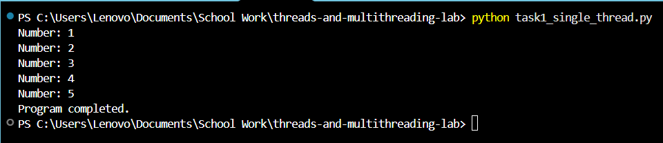
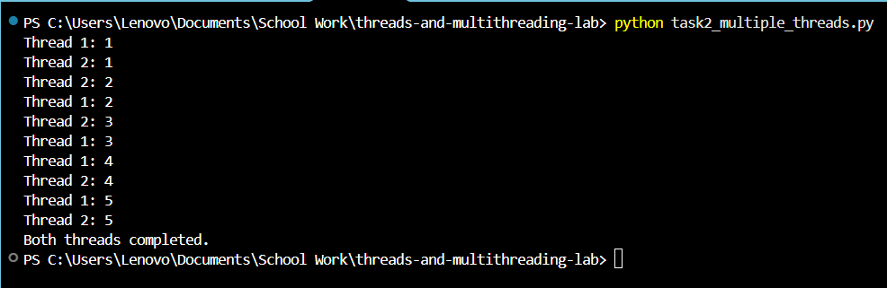
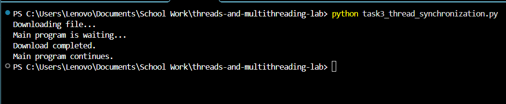
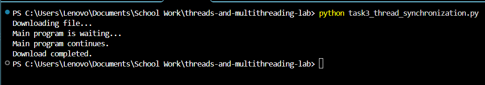
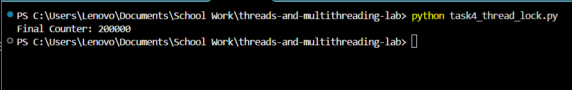
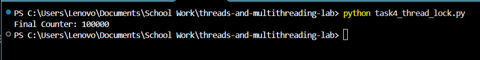

# Threads and Multithreading Laboratory

## Student Information
- Name: (Rabbah Alawi)
- Section: (B186)
- Date: (November 21, 2026)

## Laboratory Description
This laboratory demonstrates thread creation,
multithreading, thread coordination, and
shared-resource management using Python.

## Completed Tasks
1. Single Thread
2. Multiple Threads
3. Thread Synchronization using join()
4. Shared Resource Management using Lock()

## Learning Outcomes
- Create and execute threads.
- Demonstrate concurrent execution.
- Explain thread coordination.
- Apply locks to protect shared resources.

---

## Guide Questions and Answers

### Task 1: Creating and Executing a Single Thread

**1. What is the purpose of `threading.Thread()`?**
It creates a new thread object that will run a specified function (set through the `target` argument) separately from the main program.

**2. What happens when `start()` is executed?**
The thread begins running its target function. The main program does not wait; it continues running at the same time.

**3. What is the purpose of `join()`?**
`join()` makes the calling thread (here, the main program) wait until the thread has finished before moving on.

**4. What happens if `join()` is removed?**
The main program does not wait for the thread. "Program completed." may print right away, before the thread finishes printing its numbers.

---

### Task 2: Implementing Multiple Threads

**1. How many threads are created in the program?**
Two threads are created (`t1` and `t2`). Counting the main thread, three threads run in total.

**2. Do the two threads execute independently?**
Yes. Each thread runs its own function without waiting for the other, so their outputs are interleaved.

**3. Why might the output order change when the program is executed again?**
The operating system's scheduler decides which thread runs and when. Timing differs from run to run, so the order of the output can change.

**4. What is the difference between sequential and concurrent execution?**
In sequential execution, one task must finish before the next one starts. In concurrent execution, multiple tasks make progress during overlapping time periods. In this lab, the two threads finish in about 5 seconds instead of 10.

---

### Task 3: Thread Synchronization Using join()

**1. Why does the main program wait when `join()` is used?**
`join()` blocks the main thread until the download thread completes. This ensures "Main program continues." prints only after "Download completed."

**2. What happens when `join()` is removed?**
The main program does not wait, so it may finish or continue before the download thread is done. The output order changes, and "Main program continues." can appear before "Download completed."

**3. In what situations is thread synchronization necessary?**
It is necessary when one task depends on the result of another (for example, processing a file only after it finishes downloading), when threads share data, or when the program must not exit before background work is complete.

---

### Task 4: Managing Shared Resources Using Thread Locks

**1. What is a shared resource?**
A shared resource is data or a resource that multiple threads can access and modify. In this lab, it is the global variable `counter`.

**2. What is a race condition?**
A race condition is a bug where the result depends on the unpredictable timing of threads. For example, two threads read the same value of `counter`, both add 1, and one update is lost.

**3. What is the purpose of `threading.Lock()`?**
A lock allows only one thread at a time to run a protected section of code. Other threads must wait until the lock is released.

**4. What is a critical section?**
A critical section is the part of the code that accesses shared data and must not be run by more than one thread at once. Here, it is `counter += 1`.

**5. Why is synchronization important when multiple threads access shared data?**
It prevents lost updates, corrupted data, and incorrect results. It guarantees consistent and predictable behavior (the final counter is always 200000).

---

## General Questions (Section VII)

**1. What is the difference between a process and a thread?**
A process is a running program with its own separate memory space and resources. A thread is a lightweight unit of execution inside a process. Threads in the same process share its memory and resources, while processes are isolated from each other.

**2. What are the advantages of using multithreading?**
- Better responsiveness of applications
- Better use of waiting time (for example, during file or network I/O)
- Efficient resource sharing, since threads share memory
- Lower overhead than creating separate processes
- Faster handling of multiple tasks

**3. How does multithreading improve application responsiveness?**
Slow tasks (such as downloading, file reading, or heavy computation) can run in a background thread while another thread keeps the user interface active. The application does not freeze while waiting.

**4. What is the difference between concurrency and parallelism?**
Concurrency is managing multiple tasks by switching between them so that all make progress. Parallelism is running multiple tasks at the exact same moment on multiple CPU cores. Concurrency is about structure, while parallelism is about simultaneous execution.

**5. Why is a lock necessary when multiple threads access shared data?**
Without a lock, threads can read and modify the same data at the same time and overwrite each other's changes. A lock ensures only one thread modifies the data at a time.

**6. What might happen if a thread is not properly synchronized?**
Race conditions may occur, leading to wrong or inconsistent results, lost updates, corrupted data, unpredictable behavior, crashes, or deadlocks.

**7. Can multiple threads execute simultaneously on a single-core processor? Explain.**
Not truly simultaneously. A single core can run only one thread at a time. The operating system rapidly switches between threads (context switching), which gives the illusion of simultaneous execution. This is concurrency, not parallelism.

**8. How does the operating system manage kernel-level threads?**
The kernel creates, schedules, and terminates kernel-level threads. Its scheduler decides which thread gets CPU time and for how long, and it performs context switches by saving and restoring each thread's state (registers, program counter, stack). The kernel also tracks each thread's status (ready, running, waiting, terminated) and handles synchronization and blocking.

---

## Files in this Repository
- `task1_single_thread.py`
- `task2_multiple_threads.py`
- `task3_thread_synchronization.py`
- `task4_thread_lock.py`
- `README.md`
- Screenshots of program execution (all four tasks)

---

## Screenshots of Program Execution

### Task 1: Single Thread

### Task 2: Multiple Threads

### Task 3: Thread Synchronization using join()
**With `join()`:**

**Without `join()`:**

### Task 4: Shared Resource Management using Lock()
**With lock:**

**Without lock:**

